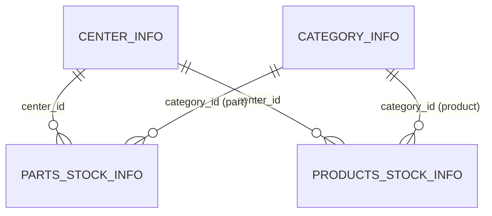

# 詳細設計書: カテゴリ・部品在庫・製品在庫 API

| 項目 | 内容 |
| --- | --- |
| 作成日 | 2026-10-21 |
| 対象 | カテゴリ API、部品在庫 API、製品在庫 API（それぞれ一覧、新規作成、編集、論理削除） |
| 参照元 | 原典の `docs/screen-specifications.md`（第 1、3、4 章）、`docs/table-definitions.md`、[er-diagram.md](er-diagram.md)、[requirements.md](requirements.md) |
| 前提 | 共通仕様（認証、応答形式、エラー形式、ページング）は [detailed-design.md](detailed-design.md) 第 4 章と、在庫センター API（同第 5 章）に従う。本書は差分だけを書く |
| 状態 | 設計済み。実装は `backend/`（API）と `frontend/`（画面。[frontend-centers-design.md](frontend-centers-design.md) 第 9 章） |

原典の優先順位（DB 定義 → API → 画面 → コード）に従う。画面仕様と DB 定義が食い違う点は、DB 定義を採用した（第 7 章）。

## 1. 概要

| リソース | ベースパス | テーブル | 画面 |
| --- | --- | --- | --- |
| カテゴリ | `/api/v1/categories` | `category_info` | カテゴリ管理（`/categories`） |
| 部品在庫 | `/api/v1/parts-stocks` | `parts_stock_info`（カテゴリ種別 `part`） | 部品在庫一覧（`/parts-stocks`） |
| 製品在庫 | `/api/v1/products-stocks` | `products_stock_info`（カテゴリ種別 `product`） | 製品在庫一覧（`/products-stocks`） |

- 認証は USER 権限以上。応答、ページング、論理削除（`delete_flag`）、成功ステータス 200 は在庫センター API と同じ。
- 部品在庫と製品在庫は別テーブル・別 API とし、応答の形を固定する（方式 A）。カテゴリ名とセンター名は結合して返し、画面が追加で呼ばなくてよい。
- 取得は結合を 1 回で行う（`@EntityGraph`）。1 行ずつ追加で取得しない。



## 2. 共通のクエリパラメータ

一覧の `page`、`size`、`sort`、`order` は在庫センター API と同じ（`page` 1 以上、`size` 1〜100、既定 20、`order` は `asc`/`desc`）。`sort` の許可リストはリソースごとに第 3〜5 章で定める。許可リスト以外は 400。同じ値が並んでもページ間で順序が変わらないよう、最後に主キーの昇順を付ける。

## 3. カテゴリ API

### 3.1 一覧 `GET /api/v1/categories`

| 名前 | 型 | 既定 | 検証 |
| --- | --- | --- | --- |
| `categoryType` | string | なし（すべて） | `part` または `product` |
| `categoryName` | string | なし | 20 文字以下。部分一致 |
| `sort` | string | `categoryType` | `categoryId`、`categoryType`、`categoryName`、`createDate`、`updateDate` |
| `order` | string | `desc` | `asc`/`desc` |

- 既定の並びは、画面仕様どおり「種別の降順、カテゴリ名の降順」。`sort=categoryType` のときは、第 2 キーを `categoryName`（同じ向き）にする。
- 応答（`CategoryResponse`）: `categoryId`、`categoryType`、`categoryName`、`description`、`createDate`、`updateDate`。
- 在庫フォームの選択肢には、`GET /categories?categoryType=part&size=100&sort=categoryName&order=asc` を使う（別の軽量 API は作らない）。

### 3.2 新規作成・編集 `POST /api/v1/categories`、`PUT /api/v1/categories/{categoryId}`

| 項目 | 必須 | 検証 |
| --- | :-: | --- |
| `categoryType` | ◯ | `part` または `product` |
| `categoryName` | ◯ | 空白不可、20 文字以下、`<` と `>` を含まない |
| `description` | × | 255 文字以下（DB の桁数）、`<` と `>` を含まない |

業務ルール:

- カテゴリ名は**同じ種別の中で**、未削除のものと重複できない（BR-03）。重複は 409 `CONFLICT`。DB の制約は付けない（部分的な一意制約が H2 と PostgreSQL で揃わないため）。**アプリ（Service）の事前照合だけで保証する**。同時リクエストの競合は防げない（第 6.1 章）。
- 編集で種別を変えるとき、そのカテゴリを参照する未削除の在庫があれば 400 `BUSINESS_ERROR`。
- 編集の対象が存在しない、または削除済みなら 404。

### 3.3 削除 `DELETE /api/v1/categories/{categoryId}`

- 論理削除。応答は `{ "result": "success" }`。存在しない、または削除済みは 404。
- **未削除の部品在庫または製品在庫から参照されているカテゴリは削除できない**（400 `BUSINESS_ERROR`）。

## 4. 部品在庫 API

### 4.1 一覧 `GET /api/v1/parts-stocks`

| 名前 | 型 | 既定 | 検証 |
| --- | --- | --- | --- |
| `categoryId` | integer | なし | 1 以上 |
| `centerId` | integer | なし | 1 以上 |
| `name` | string | なし | 100 文字以下。部分一致（大文字小文字を区別しない） |
| `amountMin` | integer | なし | 0 以上 |
| `amountMax` | integer | なし | 0 以上。`amountMin` 以上（違反は 400 `BUSINESS_ERROR`） |
| `sort` | string | `categoryName` | 下表 |
| `order` | string | `asc` | `asc`/`desc` |

| `sort` | 並べる項目 |
| --- | --- |
| `stockId` | 在庫 ID |
| `name` | 名称 |
| `amount` | 在庫数 |
| `categoryName` | カテゴリ名（結合先） |
| `centerName` | センター名（結合先） |
| `createDate`、`updateDate` | 作成・更新日時 |

- 既定の並びは、画面仕様の「カテゴリ/名称」。`sort=categoryName` のときは、第 2 キーを `name`（昇順）にする。
- 論理削除済みの在庫は返さない。カテゴリやセンターが論理削除されていても、在庫そのものは返し、名称はそのまま結合して返す。
- 応答（`PartsStockResponse`）: `stockId`、`categoryId`、`categoryName`、`name`、`centerId`、`centerName`、`description`、`amount`、`createDate`、`updateDate`。`categoryId`/`centerId` が未設定の既存行は、対応する名称も `null`。

### 4.2 新規作成・編集 `POST /api/v1/parts-stocks`、`PUT /api/v1/parts-stocks/{stockId}`

| 項目 | 必須 | 検証 |
| --- | :-: | --- |
| `categoryId` | ◯ | 存在する未削除のカテゴリで、種別が `part`。違反は 400 `BUSINESS_ERROR` |
| `name` | ◯ | 空白不可、255 文字以下（DB の桁数）、`<` と `>` を含まない |
| `centerId` | ◯ | 存在する未削除のセンター。違反は 400 `BUSINESS_ERROR` |
| `description` | × | 255 文字以下、`<` と `>` を含まない |
| `amount` | ◯ | 0 以上 999,999,999 以下の整数 |

- **名称は、同じセンターの中で、未削除のものと重複できない**（409 `CONFLICT`）。別のセンターには、同じ名称の在庫を置ける（センターごとに別の管理）。DB の制約は無く、**アプリ（Service）の事前照合だけで保証する**（第 6.1 章）。
- 編集の対象が存在しない、または削除済みなら 404。

### 4.3 削除 `DELETE /api/v1/parts-stocks/{stockId}`

論理削除。存在しない、または削除済みは 404。応答は `{ "result": "success" }`。

## 5. 製品在庫 API

部品在庫 API と同じ。差分は次のとおり。

| 項目 | 内容 |
| --- | --- |
| パス | `/api/v1/products-stocks` |
| カテゴリの種別 | `product` |
| 製品コード `productCode` | 応答に追加。入力は必須、20 文字以下、半角英数字・ハイフン・アンダースコアのみ。**削除済みを含めて一意**（409 `CONFLICT`。DB に一意制約 `uk_products_stock_product_code`） |
| 一覧の検索条件 | `productCode`（部分一致）を追加 |
| `sort` | `productCode` を追加。既定は `categoryName` |
| 応答 | `ProductsStockResponse` = `PartsStockResponse` + `productCode` |

### 5.1 製品コードの列（スキーマ変更。承認済み）

原典の画面仕様に「製品コード」があるが、`products_stock_info` に列が無かった（C-5）。`V4__add_product_code.sql` で追加する。

```sql
ALTER TABLE products_stock_info ADD COLUMN product_code VARCHAR(20);
UPDATE products_stock_info SET product_code = 'PRD-' || LPAD(CAST(stock_id AS VARCHAR(10)), 6, '0')
 WHERE product_code IS NULL;                      -- 既存の行は stock_id をゼロ埋めした値（例: stock_id=12 は PRD-000012）
ALTER TABLE products_stock_info ALTER COLUMN product_code SET NOT NULL;
ALTER TABLE products_stock_info ADD CONSTRAINT uk_products_stock_product_code UNIQUE (product_code);
```

H2 と PostgreSQL の両方で動く記述にする。開発用データは、V4 が埋めた値を使う。

- 既存の行の製品コードは **`stock_id` を 6 桁にゼロ埋めした値で、連番の管理ではない**。`stock_id` に欠番（削除や、途中で失敗した登録）があれば、製品コードにも同じ欠番ができる。デモデータ（V3）は `stock_id` が 1 から続くため、`PRD-000001` から始まる。
- 新しい行の製品コードは**利用者が入力する**（自動採番しない）。V4 の `LPAD` は 6 桁を超える部分を切り捨てるため、`stock_id` が 1,000,000 以上の行があると衝突して移行に失敗する（現在の件数では起きない）。

## 6. エラー

| 条件 | HTTP | code |
| --- | --- | --- |
| 入力の形式エラー（必須、桁数、形式、範囲、`<` `>`） | 400 | `VALIDATION_ERROR` |
| カテゴリやセンターが存在しない、カテゴリの種別が違う、参照されているカテゴリの削除・種別変更、`amountMin > amountMax`、不正な `sort` | 400 | `BUSINESS_ERROR` |
| 認証なし、無効 | 401 | `AUTH_ERROR` |
| 権限なし（リフレッシュトークンなど） | 403 | `FORBIDDEN` |
| 対象が存在しない、または削除済み | 404 | `NOT_FOUND` |
| カテゴリ名（種別内）、在庫の名称（センター内）、製品コードの重複 | 409 | `CONFLICT` |

### 6.1 重複の保証範囲と既知の制限

| 対象 | 保証の方法 | 同時リクエストの競合 |
| --- | --- | --- |
| 製品コード | **DB の一意制約** `uk_products_stock_product_code`（削除済みを含む）。Service の事前照合も行う | 防げる。`DataIntegrityViolationException` を 409 `CONFLICT` に変換する |
| カテゴリ名（種別内、未削除） | **アプリ（Service）の事前照合のみ**。DB の制約は無い | **防げない**。ほぼ同時の 2 件の登録が、どちらも照合を通過すると、同名が 2 件できる |
| 在庫の名称（センター内、未削除） | **アプリ（Service）の事前照合のみ**。DB の制約は無い | **防げない**（同上） |
| 使用中カテゴリの削除禁止 | アプリの照合のみ。外部キーは論理削除では働かない | 防げない。カテゴリの削除と、そのカテゴリを使う在庫の登録が同時に起きると、削除済みのカテゴリを指す在庫ができうる |

- 研修・社内の小規模な利用（同時利用 20 人以下、`non-functional-requirements.md`）では許容する。同じ画面の連打は、画面側で送信中のボタンを無効にして防ぐ。
- 厳密に保証する場合の案（**スキーマ変更で要承認**）: PostgreSQL の部分ユニークインデックス（`WHERE delete_flag = 0`。H2 には無いため、H2 での検証は別の方法になる）、または `delete_flag` を含めない一意制約にして論理削除時に名称を書き換える方式、または楽観ロックの `version` 列（`docs/review/test-scope-and-production-considerations-20261021.md` 項目 14）。

## 7. 画面仕様との差と判断

| # | 画面仕様 | DB 定義・判断 |
| --- | --- | --- |
| 1 | カテゴリの説明は 50 文字まで | DB は 255。**DB を採用**（255） |
| 2 | 製品在庫の名称は 20 文字まで | DB は 255。**DB を採用**（255） |
| 3 | 部品在庫の「名称は重複禁止」 | 範囲が不明。**同じセンター内で重複禁止**とした（別のセンターは同名可） |
| 4 | 製品コードの列 | DB に無かったため追加（第 5.1 章） |
| 5 | カテゴリ画面の行操作に「表示のみ」と「編集・削除」が混在（C-10） | 編集・削除を表示する（仮決定） |
| 6 | CSV での一括登録・更新・削除（カテゴリ画面） | 要件が未定義（Q-8）。**今回は対象外** |
| 7 | 在庫数は部品在庫では任意か必須か不明 | 部品・製品とも必須（製品の仕様に合わせた。DB は NULL 可） |

## 8. テスト設計

[detailed-design.md](detailed-design.md) 第 7 章に従う（Controller、Service、Repository、結合、DB スキーマ）。

| 層 | 主な観点 |
| --- | --- |
| Controller | 401、403、400（各パラメータと本文）、200、`<` `>` の拒否、境界値（20/21、255/256、`amount` の 0/-1/999,999,999/1,000,000,000） |
| Service | 重複 409、404、カテゴリの種別違い、センターなし、カテゴリの削除禁止・種別変更の禁止、`amountMin > amountMax`、不正な `sort`、論理削除 |
| Repository（H2） | 条件ごとの絞り込み、`%` `_` のエスケープ、削除済みの除外、結合名の並び替え、制約違反（NOT NULL、CHECK、一意、外部キー） |
| 結合 | カテゴリ作成 → 部品在庫の登録 → 検索 → 編集 → 削除、カテゴリの削除禁止、製品コードの重複 |
| DB スキーマ | `product_code` の NOT NULL、一意、既存行への採番 |

## 9. 今後の想定: 横断検索 API（未実装）

部品と製品をまたいで 1 つの結果にまとめる検索（例: 名称で両方を検索）は、現時点では実装しない。必要になった場合は、次のように 1 本の API にまとめる前提で拡張する。

- 例: `GET /api/v1/stocks/search?q=...&type=part|product|all`。部品在庫と製品在庫を `UNION` し、共通の項目（種別、ID、名称、カテゴリ名、センター名、数量）を 1 本のページングで返す。
- 画面から 2 つの API を別々に呼ぶと、ページングを統合できない。統合したい場合だけ、この API を追加する。
- 既存の 3 つの API の応答は変えずに追加できる（後方互換）。
