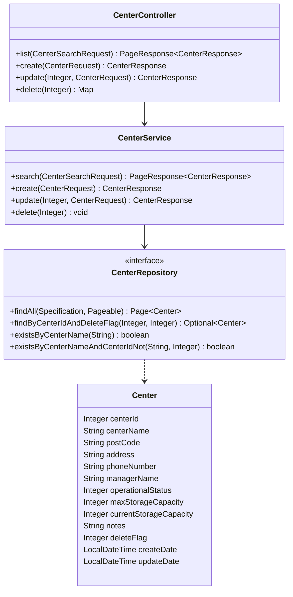
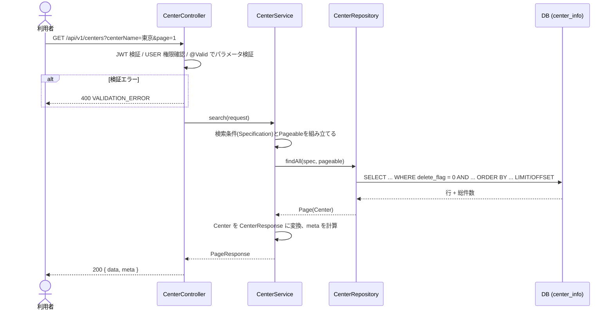

# 詳細設計書: 在庫センター API

| 項目 | 内容 |
| --- | --- |
| 作成日 | 2026-10-14 |
| 版 | 0.1（ドラフト） |
| 対象 | 在庫センター API（一覧取得、新規作成、編集、論理削除） |
| 参照元 | 原典 `docs/api-interface-spec.md`、`docs/table-definitions.md`、`docs/screen-specifications.md`、`.github/instructions/backend/**`、`backend/` のコード |
| 関連資料 | [requirements.md](requirements.md)、[er-diagram.md](er-diagram.md)、[non-functional-requirements.md](non-functional-requirements.md) |

出典の記号は [requirements.md](requirements.md) と同じ（**[原典]**、**[実装]**、**[提案]**）。この設計書は、原典の API 仕様とテーブル定義を前提にし、原典の開発規約（コントローラー、サービス、リポジトリの責務）に従う。

## 1. 設計方針

| 方針 | 内容 | 出典 |
| --- | --- | --- |
| アーキテクチャ | Controller、Service、Repository の MVC。依存はコンストラクタインジェクション | [原典 backend.instructions] |
| 責務 | Controller は認証・認可、入力検証、Service への委譲。Service は業務ロジックとトランザクション。Repository は Spring Data JPA | [原典 instructions] |
| 検証 | Controller で `@Valid` による形式検証、Service で業務ルールの整合性検証（二重に行う） | [原典 instructions] |
| 例外 | 独自例外（`NotFoundException`、`BusinessException` など）を `GlobalExceptionHandler` で共通形式に変換する | [原典] |
| 契約の優先順位 | `table-definitions.md`、API 仕様、画面仕様、コードの順。不一致はドキュメントを先に直す | [原典 copilot-instructions] |
| 言語 | Javadoc、コメント、ユーザー向けメッセージは日本語 | [原典 copilot-instructions] |
| 禁止事項 | ハードコーディング（定数、enum にする）、秘密情報の埋め込み、PII のログ出力 | [原典] |

## 2. パッケージ構成

原典の構成（`controller/auth`、`service/auth`、`repository/user` のようにドメイン単位で分ける）に合わせる。

```
com.aojt.mgmt
├── controller/center/CenterController
├── service/center/CenterService
├── repository/center/CenterRepository
├── model/Center                      （テーブル center_info に対応するエンティティ）
├── dto/center/
│   ├── CenterSearchRequest           （一覧のクエリパラメータ）
│   ├── CenterRequest                 （作成・更新の本文）
│   └── CenterResponse
├── dto/common/
│   ├── ErrorResponse                 （原典に既存）
│   └── PageResponse                  （data と meta）
├── exception/                        （BusinessException、NotFoundException。必要なら ConflictException を追加）
└── model/CenterOperationalStatus     （稼働状況の enum。0 = 稼働中、1 = 稼働停止）
```

## 3. クラス設計



## 4. 共通仕様（再掲と補足）

| 項目 | 内容 | 出典 |
| --- | --- | --- |
| ベースパス | `/api/v1`。在庫センターは `/api/v1/centers` | [原典] |
| 認証 | JWT（`Authorization: Bearer <accessToken>`）。USER 権限以上 | [原典] |
| 日時 | ISO 8601 のオフセットなし（例 `2025-01-15T10:30:00`）。サーバーの既定タイムゾーンで扱う | [原典 例] / [提案] 運用タイムゾーンは要確認 |
| 一覧の応答 | `{ "data": [...], "meta": { "total", "page", "size", "totalPages" } }` | [原典] |
| 削除の応答 | `{ "result": "success" }` | [原典] |
| エラーの応答 | `{ "error": { "code", "message", "timestamp" } }` | [原典] |
| 成功ステータス | 作成、更新、削除はすべて 200 | [原典] |

### 4.1 エラーコード

| HTTP | code | 発生条件 | 出典 |
| --- | --- | --- | --- |
| 400 | `VALIDATION_ERROR` | 入力の形式エラー（桁数、形式、範囲、不正なパラメータ） | [実装] |
| 400 | `BUSINESS_ERROR` | 業務ルール違反（容量超過、在庫が残るセンターの削除など） | [実装] |
| 401 | `AUTH_ERROR` | 認証失敗、トークンなし、無効 | [実装] |
| 403 | `FORBIDDEN` | 権限不足 | [実装] |
| 404 | `NOT_FOUND` | センターが存在しない、または削除済み | [実装] |
| 409 | `CONFLICT` | センター名の重複、同時更新の競合 | [提案] API 仕様は 409 を定めるが、原典の例外ハンドラに対応がない |
| 500 | `INTERNAL_ERROR` | 想定外のエラー。詳細はクライアントに返さない | [実装] |

メッセージは日本語のユーザー向け文言にする。項目ごとのエラーを画面に出すため、`error.details`（`[{ "field", "message" }]`）の追加を提案する（API 契約の変更なので要承認）。

## 5. API 詳細

### 5.1 在庫センター一覧取得 `GET /api/v1/centers`

#### 入力（クエリパラメータ）

| 名前 | 型 | 必須 | 既定値 | 検証 | 出典 |
| --- | --- | --- | --- | --- | --- |
| `centerName` | string | × | なし | 20 文字以下。部分一致 | [原典] |
| `address` | string | × | なし | 100 文字以下。部分一致 | [原典] |
| `operationalStatus` | integer | × | なし | 0 または 1 | [原典] |
| `page` | integer | × | 1 | 1 以上 | [原典] |
| `size` | integer | × | 20 | 1 以上 100 以下 | [原典] |
| `sort` | string | × | `centerId` | 下表の値のみ | [原典] |
| `order` | string | × | `desc` | `asc` または `desc` | [原典] |

#### ソート項目の対応

| `sort` の値 | エンティティの項目 | 列 |
| --- | --- | --- |
| `centerId` | `centerId` | `center_id` |
| `centerName` | `centerName` | `center_name` |
| `address` | `address` | `address` |
| `operationalStatus` | `operationalStatus` | `operational_status` |
| `maxStorageCapacity` | `maxStorageCapacity` | `max_storage_capacity` |
| `currentStorageCapacity` | `currentStorageCapacity` | `current_storage_capacity` |
| `createDate` | `createDate` | `create_date` |
| `updateDate` | `updateDate` | `update_date` |

- 許可リスト以外は 400。ソートのキーを列名として SQL に連結しない。
- 同じ値が並ぶと、ページをまたいで順序が不安定になるため、第 2 ソートキーに `centerId` の昇順を付ける [提案]。

#### 処理フロー



#### 検索条件（概念 SQL）

```sql
SELECT center_id, center_name, post_code, address, phone_number, manager_name,
       operational_status, max_storage_capacity, current_storage_capacity,
       notes, create_date, update_date
FROM center_info
WHERE delete_flag = 0
  AND (:centerName IS NULL OR LOWER(center_name) LIKE '%' || LOWER(:escapedCenterName) || '%' ESCAPE '\')
  AND (:address    IS NULL OR LOWER(address)     LIKE '%' || LOWER(:escapedAddress)    || '%' ESCAPE '\')
  AND (:operationalStatus IS NULL OR operational_status = :operationalStatus)
ORDER BY <許可リストで解決した列> <asc|desc>, center_id ASC
LIMIT :size OFFSET (:page - 1) * :size
```

- 条件が空文字または空白のみなら、その条件は使わない。
- 検索語の `%`、`_`、`\` はワイルドカードにせず、エスケープして文字として扱う。
- 実装は JPA の `Specification`（パラメータ化クエリ）で行い、SQL を文字列連結しない。

#### 出力

- 200: `PageResponse<CenterResponse>`。`meta.page` は 1 始まり、`meta.totalPages` は総件数と `size` から計算する。
- 0 件でも 200 で、`data` は空配列。`page` が総ページ数を超える場合も 200 で空配列 [提案: 仕様書に明記]。
- `CenterResponse` の項目は `centerId`、`centerName`、`postCode`、`address`、`phoneNumber`、`managerName`、`operationalStatus`、`maxStorageCapacity`、`currentStorageCapacity`、`notes`、`createDate`、`updateDate`。`deleteFlag` は返さない。

#### エラー

| 条件 | HTTP | code |
| --- | --- | --- |
| パラメータの検証エラー | 400 | `VALIDATION_ERROR` |
| トークンなし、無効 | 401 | `AUTH_ERROR` |
| USER 権限なし | 403 | `FORBIDDEN` |

### 5.2 在庫センター新規作成 `POST /api/v1/centers`

#### 入力（JSON 本文）と検証

| 項目 | 型 | 必須 | 検証（テーブル定義に準拠） | 出典 |
| --- | --- | --- | --- | --- |
| `centerName` | string | ◯ | 空白不可、20 文字以下、重複禁止 | [原典] |
| `postCode` | string | ◯ | 10 文字以下、`123-4567` の形式 | [原典] 必須と桁数 / [提案] 形式の正規表現 |
| `address` | string | ◯ | 255 文字以下 | [原典] |
| `phoneNumber` | string | ◯ | 20 文字以下、電話番号の形式 | [原典] 必須と桁数 / [提案] 形式の正規表現 |
| `managerName` | string | ◯ | 100 文字以下 | [原典] |
| `operationalStatus` | integer | ◯ | 0 または 1 | [原典] |
| `maxStorageCapacity` | integer | × | 0 以上 | [原典] 任意 / [提案] 0 以上 |
| `currentStorageCapacity` | integer | × | 0 以上。両方指定時は最大以下 | [提案] BR-10 |
| `notes` | string | × | 255 文字以下 | [原典] |

- 文字列の `<`、`>` を含む入力は拒否する [提案]（BR-08 の XSS 対策）。出力側のエスケープは画面（React）が担う。
- 画面は住所を「都道府県、市区町村、番地」に分けて入力するが、API は `address` 1 本とする。画面側で結合して送る [提案、要確認 C-4]。

#### 処理フロー

1. Controller で JWT と権限、`@Valid` による形式検証。
2. Service（`@Transactional`）で、センター名の重複を確認する（存在すれば 409）。
3. 容量の整合（BR-10）を確認する（違反なら 400 `BUSINESS_ERROR`）。
4. エンティティを作成し、`delete_flag = 0`、`create_date`、`update_date` を設定して保存する。
5. 保存結果を `CenterResponse` にして 200 で返す。
6. 重複確認と保存の間の競合は DB のユニーク制約で検出し、409 に変換する。

#### エラー

| 条件 | HTTP | code |
| --- | --- | --- |
| 必須漏れ、桁数、形式違反 | 400 | `VALIDATION_ERROR` |
| 容量超過 | 400 | `BUSINESS_ERROR` |
| センター名の重複 | 409 | `CONFLICT` |

### 5.3 在庫センター編集 `PUT /api/v1/centers/{centerId}`

- 入力と検証は新規作成と同じ。`centerId` は未削除のレコードを指すこと。
- 処理:
  1. 未削除のセンターを取得する。なければ 404 `NOT_FOUND`。
  2. 自分以外に同名があれば 409。
  3. 全項目を置き換えて保存する（`create_date` は変えない）。
  4. 更新後の `CenterResponse` を 200 で返す。
- 同時更新への対策として、楽観ロック（`version` 列）を使い、競合時は 409 を返す [提案。列の追加は要承認]。

### 5.4 在庫センター削除 `DELETE /api/v1/centers/{centerId}`

- 処理:
  1. 未削除のセンターを取得する。なければ 404。
  2. `delete_flag = 1` にして保存する（物理削除はしない）。
  3. `{ "result": "success" }` を 200 で返す。
- 削除済みのセンターに再度 DELETE すると 404。
- 在庫が紐づくセンターの扱い（BR-11）は **要確認**（Q-3）。禁止する場合は、未削除の `parts_stock_info`、`products_stock_info` の存在を確認し、あれば 400 `BUSINESS_ERROR` を返す。

## 6. 認証・認可の設計（再実装した部分の要点）

| 項目 | 内容 | 出典 |
| --- | --- | --- |
| トークン | RS256 署名の JWT。アクセストークンは `roles` クレームを含み、リフレッシュトークンは含めない | [原典] |
| 権限の変換 | `roles` クレーム（例 `USER`）に `ROLE_` を付けて権限にする | [原典] |
| 公開エンドポイント | `/api/v1/auth/**`、Swagger（`/v3/api-docs/**`、`/swagger-ui/**`） | [原典] |
| 認証失敗 | 401。ユーザーの存在有無を応答で区別しない | [提案] |
| トークンの種類 | `token_type` クレームでアクセスとリフレッシュを区別し、リフレッシュで API を呼べないようにする | [提案] hands_ON では実装済み |

## 7. テスト設計

原典の規約（`.github/instructions/backend/ut/**`）に従う。

| 層 | 方針 | 主な観点 |
| --- | --- | --- |
| Controller | `MockMvc`、`@WithMockUser`。認証・認可・検証・異常系 | 401、403、400（各パラメータ）、200、正しい JSON の形 |
| Service | JUnit 5 と Mockito。`@Mock`/`@InjectMocks` | 重複 409、404、容量超過、ソートの解決、`meta` の計算、論理削除 |
| Repository | H2 を使用。正常、異常、境界値 | 削除済みの除外、部分一致、`%`、`_` のエスケープ、並び順の安定性 |
| 共通 | テストクラスに目的、メソッドに検証内容の Javadoc。メソッド名は期待動作を表す | — |
| カバレッジ | JaCoCo の命令カバレッジ 80% 以上（`mvn verify`） | [原典 `pom.xml`] |
| 結合 | 本番 DB（PostgreSQL）での検索・制約の確認 | [提案] 非機能要件 NFR-MIG を参照 |

### 7.1 境界値の例（一覧）

| 項目 | 値 | 期待 |
| --- | --- | --- |
| `page` | 0 / 1 | 400 / 200 |
| `size` | 0 / 1 / 100 / 101 | 400 / 200 / 200 / 400 |
| `centerName` | 20 文字 / 21 文字 | 200 / 400 |
| `address` | 100 文字 / 101 文字 | 200 / 400 |
| `operationalStatus` | -1 / 0 / 1 / 2 | 400 / 200 / 200 / 400 |
| `sort` | `centerId` / `password` | 200 / 400 |
| `order` | `asc` / `ASC` / `up` | 200 / 200（大文字小文字は区別しない）/ 400 |

## 8. 現在の hands_ON の実装と原典の差分

hands_ON の実装は、原典のドキュメントとコードを参照する前に作った。次の差があり、**原典に合わせるのが原則**（「ドキュメントを先に直し、実装を合わせる」）。DB スキーマと API 契約の変更は要承認のため、方針の確認後に着手する。

| 区分 | 原典 | hands_ON（2026-10-14 時点） | 状況 |
| --- | --- | --- | --- |
| テーブル・列 | `center_info`。桁数、NOT NULL は [er-diagram.md](er-diagram.md) 第 7 章 | 同じに修正済み（API の入力検証も合わせた） | **解消済** |
| スキーマ管理 | Flyway | Flyway（`V1__initial.sql`、開発用データは `db/seed-dev`）。`ddl-auto=validate` | **解消済** |
| パッケージ | `controller/center` のようにドメイン単位 | 層ごとにフラット | 未対応（原典に合わせる方針。DB の次に実施） |
| 言語 | Javadoc、メッセージは日本語 | 英語のメッセージ、コメントが少ない | 未対応 |
| エラーコード | `AUTH_ERROR`、`INTERNAL_ERROR`、`BUSINESS_ERROR` | `UNAUTHORIZED`、`INTERNAL_SERVER_ERROR`、`BAD_REQUEST` | 未対応。409 は `CONFLICT` を追加する方針 |
| ユーザー取得 | `User` エンティティを返す（パスワードのハッシュを含む） | DTO を返し、本人または ADMIN のみ | 実装を維持し、API 仕様書を更新 |
| トークン | アクセス 24 時間、リフレッシュ 7 日。`token_type` なし | アクセス 15 分、リフレッシュ 7 日、`token_type` あり | **今は変更しない**（決定済み） |
| テスト | 層ごとのユニットテスト、JaCoCo 80% | API の結合テスト 13 件と DB スキーマテスト 12 件（`DatabaseSchemaTest`） | 一部対応（サービス層、コントローラー層のユニットテストと JaCoCo は未対応） |
| Lombok | 使用 | 不使用 | 要確認（新規依存の扱い） |
| `capacityConsistent` | — | `@JsonIgnore` を付けて OpenAPI の入力項目から除外済 | **解消済** |

## 9. 他の API（次の詳細設計の対象。提案）

原典に API 仕様が無いもの。同じ形式（`data`/`meta`、論理削除、USER 以上）で設計する。

| リソース | エンドポイント案 | 備考 |
| --- | --- | --- |
| カテゴリ | `GET/POST /api/v1/categories`、`PUT/DELETE /api/v1/categories/{categoryId}` | 検索は `categoryType`、`categoryName`。種別内で名称が一意 |
| 部品在庫 | `GET/POST /api/v1/parts-stocks`、`PUT/DELETE /api/v1/parts-stocks/{stockId}` | 検索は `categoryId`、`name`、`amountMin`、`amountMax`。カテゴリは種別 `part`、センターの存在を検証 |
| 製品在庫 | `GET/POST /api/v1/products-stocks`、`PUT/DELETE /api/v1/products-stocks/{stockId}` | 製品コードの列が必要（C-5） |
| 操作履歴 | `GET /api/v1/operation-history` | スコープ未定（Q-6） |
