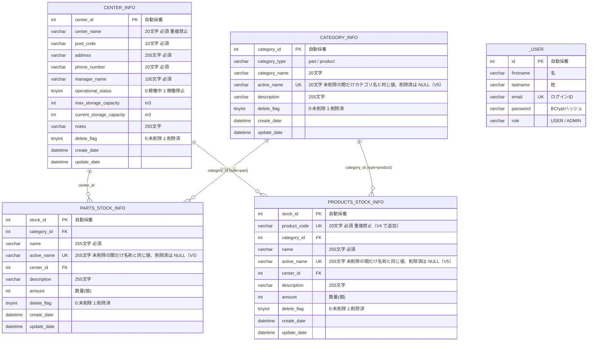
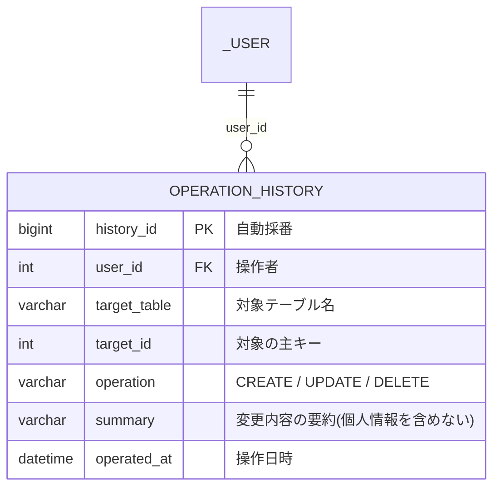

# ER 図・テーブル設計: Inventrack

| 項目 | 内容 |
| --- | --- |
| 作成日 | 2026-10-14 |
| 参照元 | 原典 `docs/table-definitions.md`、`backend/src/main/resources/db/migration/V1__create_categories_table.sql`、`backend/.../model/User.java` |
| 関連資料 | [requirements.md](requirements.md)、[detailed-design.md](detailed-design.md) |

出典の記号は [requirements.md](requirements.md) と同じ。**[原典]** は原典、**[提案]** は本書の仮置き。

## 1. ER 図（原典の定義）

テーブルは 5 つ。`center_info` と `category_info` が、部品在庫と製品在庫から参照される。`_user` は他のテーブルと関連を持たない。

## 2. 関連（リレーション）

| 親 | 子 | 外部キー | 多重度 | 備考 |
| --- | --- | --- | --- | --- |
| `center_info` | `parts_stock_info` | `center_id` | 1 対 0 以上 | [原典] 外部キー制約あり。カスケード指定なし |
| `center_info` | `products_stock_info` | `center_id` | 1 対 0 以上 | 同上 |
| `category_info` | `parts_stock_info` | `category_id` | 1 対 0 以上 | [原典] 参照先の `category_type` が `part` であることは、運用ルール（アプリの検証）で保証する |
| `category_info` | `products_stock_info` | `category_id` | 1 対 0 以上 | 同上。`product` であることを保証する |

- 在庫テーブルの `category_id`、`center_id` は NULL を許す [原典]。画面仕様は必須としているため、アプリ側で必須検証する。
- 論理削除のため、削除したセンターやカテゴリを参照する在庫行が残る。外部キー制約では防げない。**削除時の扱いは要確認**（[requirements.md](requirements.md) Q-3）。

## 3. テーブル定義の要点

### 3.1 `center_info`（在庫センター。今回の対象）

| 物理名 | 型 | NOT NULL | 説明 | 出典 |
| --- | --- | :-: | --- | --- |
| center_id | INT（自動採番） | ◯ | 主キー | [原典] |
| center_name | VARCHAR(20) | ◯ | 在庫センター名。重複禁止 | [原典] |
| post_code | VARCHAR(10) | ◯ | 郵便番号 | [原典] |
| address | VARCHAR(255) | ◯ | 住所 | [原典] |
| phone_number | VARCHAR(20) | ◯ | 電話番号（管理者の電話番号） | [原典] |
| manager_name | VARCHAR(100) | ◯ | 管理者名 | [原典] |
| operational_status | TINYINT | ◯ | 0 = 稼働中、1 = 稼働停止。SQL の既定値は 0 | [原典] |
| max_storage_capacity | INT |  | 最大保管容量（m³） | [原典] |
| current_storage_capacity | INT |  | 現在保管容量（m³） | [原典] |
| notes | VARCHAR(255) |  | 備考 | [原典] |
| delete_flag | TINYINT | ◯ | 0 = 未削除、1 = 削除済。SQL の既定値は 0 | [原典] |
| create_date | DATETIME |  | 作成日時 | [原典] |
| update_date | DATETIME |  | 更新日時 | [原典] |

### 3.2 `_user`

| 物理名 | 型 | NOT NULL | 説明 | 出典 |
| --- | --- | :-: | --- | --- |
| id | INT（自動採番） | ◯ | 主キー | [原典] |
| firstname、lastname | VARCHAR(100) | ◯ | 名、姓 | [原典 SQL] |
| email | VARCHAR(255) | ◯ | ユニーク制約あり。テーブル定義書は 320 桁、SQL は 255 | [原典] |
| password | VARCHAR(255) | ◯ | BCrypt のハッシュ | [原典] |
| role | VARCHAR(50) | ◯ | `USER` または `ADMIN`（CHECK 制約）。既定値 `USER` | [原典 SQL] |

テーブル名が `_user` なのは、エンティティの `@Table(name = "_user")` に合わせたため [原典 テーブル定義書の備考]。

### 3.3 `category_info`、`parts_stock_info`、`products_stock_info`

原典の `docs/table-definitions.md` と上の ER 図のとおり。`category_info.category_name` は 20 文字、`name`（在庫）は 255 文字。

**製品コード（2026-10-21 追加）**: 原典の画面仕様（製品在庫一覧）に「製品コード」があるが、原典の `products_stock_info` に列が無かった（[requirements.md](requirements.md) C-5）。`V4__add_product_code.sql` で次の列を追加した。

| 物理名 | 型 | NOT NULL | 説明 | 出典 |
| --- | --- | :-: | --- | --- |
| product_code | VARCHAR(20) | ◯ | 製品コード。削除済みを含めて一意（制約 `uk_products_stock_product_code`。DB で保証）。V4 で、既存の行に `PRD-` + stock_id（6 桁ゼロ埋め、例 `PRD-000012`）を入れた。**連番管理ではない**（stock_id の欠番はコードにも欠番）。新規の行は入力する | [提案] 画面仕様 |

**名称の一意制約（2026-10-24 追加、V5）**: 「同じセンターの中で、未削除どうしの名称が重複しない」（在庫）と「同じ種別の中で、未削除どうしのカテゴリ名が重複しない」を、Service の事前照合に加えて DB でも保証する。削除済みの行は重複してよいため、「削除済みを含めた一意制約」は使えない。部分ユニークインデックスは H2 に無いため、次の列を使う。

| 物理名 | 型 | NOT NULL | 説明 | 出典 |
| --- | --- | :-: | --- | --- |
| category_info.active_name | VARCHAR(20) |  | 未削除の間だけ `category_name` と同じ値、削除済は NULL。一意制約 `uk_category_active_name (category_type, active_name)` | [提案] V5 |
| parts_stock_info.active_name | VARCHAR(255) |  | 未削除の間だけ `name` と同じ値、削除済は NULL。一意制約 `uk_parts_stock_active_name (center_id, active_name)` | [提案] V5 |
| products_stock_info.active_name | VARCHAR(255) |  | 同上。一意制約 `uk_products_stock_active_name (center_id, active_name)` | [提案] V5 |

- 一意制約では NULL どうしが重複と見なされない（H2、PostgreSQL とも）。この性質で、削除済みは何件でも、未削除は 1 件だけになる。
- `active_name` はエンティティが名称と削除フラグから設定する。**直接 SQL で行を追加・更新するときは、未削除なら name と同じ値を入れること**（入れ忘れた行は制約の対象にならない）。
- 在庫の `center_id` が NULL の行（原典で許している。API では作れない）は制約の対象にならない。
- 既存データに未削除どうしの重複があると、V5 の適用は制約違反で失敗する。本番に適用する前に、データのコピーで確認する。

同時リクエストでの「使用中カテゴリの削除」と「そのカテゴリを使う在庫の登録」の矛盾は、論理削除では外部キーが働かないため、カテゴリの行ロック（`SELECT ... FOR UPDATE`）で直列にして防ぐ（アプリ側。[detailed-design-stocks.md](detailed-design-stocks.md) 第 6.1 章）。同じ行を 2 人が編集したときの「更新の消失」は防げない（楽観ロックは未決）。

## 4. インデックスと制約

原典のテーブル定義書は、索引を主キーと外部キーの列にだけ示している。**2026-10-14 に DB を再設計し、次のうち「実装済」を Flyway の `V1__initial.sql` に反映した**。「未決」は要確認のため入れていない。

| 対象 | 内容 | 目的 | 状況 |
| --- | --- | --- | --- |
| `center_info.center_name` | ユニーク制約（削除済みを含む） | BR-02（重複禁止）を DB でも守る。API 仕様書の「DB ユニーク制約」に対応 | **実装済**。削除済みを含めるかは未決（Q-5）。含めない場合は PostgreSQL の部分ユニークインデックス（`WHERE delete_flag = 0`）が必要で、H2 には無い |
| `parts_stock_info`、`products_stock_info` の `category_id`、`center_id` | インデックス | 結合、絞り込み。原典の「索引 2」に対応。外部キーは PostgreSQL では自動で索引にならない | **実装済** |
| `delete_flag`、`operational_status`、`category_type`、`role` | CHECK 制約（許可値のみ） | 不正値の防止。`role` は原典 SQL にもある | **実装済** |
| 在庫の `amount`、センターの容量 | CHECK 制約（0 以上、NULL は許可） | 負数の防止。画面仕様「在庫数は 0 以上」に対応 | **実装済** |
| `_user.email` | ユニーク制約 | ログイン ID の重複防止 | **実装済**（原典 SQL にもある） |
| `center_info (delete_flag, operational_status)` | 複合インデックス | 一覧の絞り込み | 未実施（件数が増えた場合のみ） |
| `products_stock_info.product_code` | ユニーク制約（削除済みを含む） | 製品コードの重複防止 | **実装済**（V4、`uk_products_stock_product_code`） |
| `category_info (category_type, active_name)` | ユニーク制約 `uk_category_active_name`（未削除どうしで一意。削除済は NULL） | BR-03 | **実装済**（V5）。同時リクエストの競合も防げる |
| `parts_stock_info`、`products_stock_info` の `(center_id, active_name)` | ユニーク制約 `uk_parts_stock_active_name`、`uk_products_stock_active_name` | BR-04（同じセンター内で重複禁止） | **実装済**（V5） |
| `center_info.version` ほか | 楽観ロック用の `version` 列 | 同時更新による更新の消失の防止 | 未決（要確認） |

## 5. 拡張案: 操作履歴（提案）

原典のサイドバーに「操作履歴一覧」があるが、テーブルも仕様も無い。次の 1 テーブルを仮置きする。**スコープと記録項目は要確認**（Q-6）。

## 6. データ移行・環境差異

- 開発は H2、本番は PostgreSQL [原典 ADR-0003]。Flyway のマイグレーション SQL は両方で動く記述にする。
- 差異に注意する項目:
  - `TINYINT` は PostgreSQL に無い（`SMALLINT` に置き換える）。
  - `DATETIME` は PostgreSQL では `TIMESTAMP`。
  - 大文字小文字、`LIKE` の照合順序、`ESCAPE` の挙動。
  - 部分インデックス。
- 原典の `V1__create_categories_table.sql` は `TINYINT` を使っており、PostgreSQL には無い型のため、そのままでは動かない。→ **hands_ON では `SMALLINT` に置き換え済み**。列の意味（0/1 のフラグ）は変わらない。原典の `docs/table-definitions.md` の型表記（TINYINT）も、この置き換えを反映する更新が必要（「ドキュメントを先に直す」原則）。
- PostgreSQL での実際の検証は未実施（次の作業）。

### 6.1 開発用データ（Flyway のデータ用フォルダー）

スキーマ（`db/migration`）とデータを分けている。データは開発・テストだけで読み込み、本番では `spring.flyway.locations` を `classpath:db/migration` だけにする。

| フォルダー | バージョン | 内容 | 読み込み先 |
| --- | --- | --- | --- |
| `db/migration` | V1 | スキーマ（5 テーブル、制約、索引） | すべての環境 |
| `db/seed-dev` | V2 | 最小の初期データ: カテゴリ 16、センター 3（東京、大阪、名古屋）、部品在庫 20、製品在庫 12 | 開発、テスト |
| `db/seed-demo` | V3 | 動作確認用のデモデータ: センター 19 件を追加（合計 22）、部品在庫 38、製品在庫 19 を追加（合計 58、合計 31） | 開発のみ。**テストは読み込まない**（`application-test.yml`。テストの期待値は V2 の 3 件のまま） |
| `db/migration` | V4 | 製品在庫に `product_code` を追加（既存行に `PRD-` + stock_id（6 桁ゼロ埋め）を入れ、NOT NULL と一意制約） | すべての環境。V3 の後に適用されるため、V3 のデモ行も採番される |
| `db/migration` | V5 | カテゴリと在庫に `active_name` を追加（未削除なら名称と同じ値、削除済は NULL）し、未削除どうしの名称の一意制約を付ける | すべての環境。既存行は V5 が埋める。既存データに未削除どうしの重複があると失敗する |

デモデータ（V3）の設計:

- 在庫センター 22 件の紐づき（ツリー）: `center_info` → `parts_stock_info`（各センター 2 件）、`products_stock_info`（各センター 1 件）。このカテゴリは `category_info` を参照する。
- 地域は北海道から沖縄まで（札幌、仙台、さいたま、千葉、横浜、新潟、金沢、静岡、浜松、四日市、京都、神戸、岡山、広島、高松、福岡、熊本、鹿児島、沖縄）。住所は都道府県、政令指定都市の区（札幌市中央区など）、「四日市市」、「郡と町」（沖縄）を含む。画面の住所分割（`docs/frontend-centers-design.md` 第 4 章）の確認に使える。
- バリエーション: 稼働停止 3 件（新潟、高松、沖縄）、容量未設定（NULL）1 件（沖縄）、備考なし 4 件。現在容量は最大容量以下。稼働停止のセンターの在庫数量は 0（沖縄を除く）。
- 住所、電話番号、担当者名は架空のサンプル。番地は仮の値（1-1 など）。
- 在庫のセンターは ID ではなくセンター名で引く。開発用 DB に手動で追加したセンターがあっても、紐づきがずれない。
- 既存の開発用 DB（V2 適用済み）は、再起動すると V3 だけが追加で適用される（DB を作り直す必要はない）。同名のセンターが既にあると、ユニーク制約で起動に失敗する。その場合は `backend/target/testdb.mv.db` を削除して作り直す。
- 検証: `DemoSeedDataTest`（件数、すべてのセンターに部品・製品が紐づくこと、カテゴリ種別、稼働停止、容量、郵便番号・電話番号の形式）。

## 7. 原典と hands_ON の差分（2026-10-14 の DB 再設計後）

初稿では hands_ON の実装が原典と食い違っていたが、原典のテーブル定義に合わせて修正した。現在の差分と対応状況を示す。

| 項目 | 原典 | hands_ON（現在） | 状況 |
| --- | --- | --- | --- |
| テーブル名、列名 | `center_info` ほか | 同じ | 解消済 |
| `post_code`、`address`、`phone_number`、`manager_name` | 桁数 10/255/20/100、必須 | 同じ（API の検証も必須と桁数を合わせた） | 解消済 |
| `max_storage_capacity`、`current_storage_capacity` | 任意（NULL 可） | 同じ（API も任意） | 解消済 |
| `notes` | VARCHAR(255) | 同じ | 解消済 |
| `_user` のテーブル名と列の桁数 | `_user`、100/100/255 | 同じ | 解消済 |
| スキーマ管理 | Flyway（`ddl-auto=update` も有効で二重管理） | Flyway のみ。Hibernate は `ddl-auto=validate` | 解消済（原典の二重管理を解消） |
| 初期データ | V1 SQL に同居。`PARTS`/`PRODUCT`、稼働状況 1 | `db/seed-dev/V2` に分離。`part`/`product`、稼働状況 0（テーブル定義を優先） | 解消済（C-1、C-2） |
| 型 | `TINYINT`、`DATETIME` | `SMALLINT`、`TIMESTAMP`（PostgreSQL 互換） | 変更。原典のドキュメントの更新が必要 |
| エンティティ | `center_info` 用のエンティティ（クラス名は別） | クラス名 `Center`（`model` パッケージ、`center_info` にマップ） | 解消済 |
| カテゴリ、部品・製品在庫のエンティティ | あり | `Category`、`PartsStock`、`ProductsStock`（`model` パッケージ） | 解消済（API とともに作成） |
